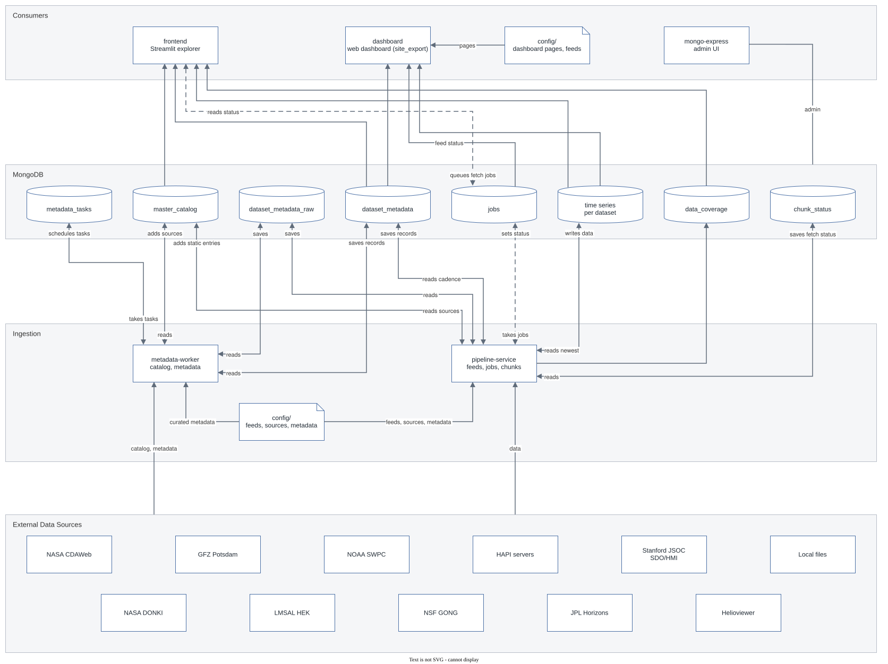

# Space Weather Analysis

A self-hostable data platform that ingests, stores, and visualizes space-weather time-series data from multiple providers through a MongoDB-backed Streamlit dashboard.

## Table of Contents

- [Overview](#overview)
- [Features](#features)
- [Architecture](#architecture)
- [Data Sources and Licenses](#data-sources-and-licenses)
- [Tech Stack](#tech-stack)
- [Getting Started](#getting-started)
- [Project Structure](#project-structure)
- [Background](#background)
- [Authors](#authors)
- [License](#license)

## Overview

Space-weather data is distributed across several providers, formats, and APIs: NASA's CDAWeb, GFZ Potsdam, HAPI servers, and plain CSV/text catalogs. This project collects these heterogeneous time-series sources into a single MongoDB store and serves them through an interactive Streamlit dashboard.

The data model follows the physical chain of space weather: phenomena originate at the Sun, propagate through the heliosphere, and drive activity in Earth's magnetosphere. The system is designed to run as a containerized, always-on service.

## Features

- Ingestion of time-series data from NASA CDAWeb, GFZ, HAPI servers, and local catalogs through a common pipeline.
- A catalog layer that discovers available datasets and maintains a master catalog the dashboard queries.
- Descriptive metadata stored for every dataset and shown in the dashboard alongside the data.
- Storage of all ingested data in MongoDB, using GridFS for large binary files.
- A Streamlit dashboard for selecting a dataset and timeframe, loading it from storage, and rendering type-appropriate plots.
- Domain-specific visualizations for sunspots and solar cycles, CME events, the Kp geomagnetic index, X-ray flux, and particle measurements.
- On-demand fetching: when requested data is not yet stored, the frontend queues a job for the pipeline service to retrieve it.
- A Docker Compose stack that runs the collector, pipeline, frontend, database, and database admin UI together.

## Architecture

The system is a modular monolith: a shared core library (`space_weather_analysis`) plus three separately-runnable components. All components share one codebase and one Docker image and communicate through MongoDB rather than over the network.

- Catalog Collector: discovers available datasets from the providers and builds the master catalog and the dataset metadata. It runs as its own entrypoint because a full discovery pass is long-running.
- Metadata Worker: a long-running background process that repeats all metadata requests (HAPI metadata mirror, dataset availability) on a schedule, one request at a time with a random pause per provider host, keeping the last good state when a provider is unreachable.
- Pipeline Service: fetches, parses, and normalizes data for a dataset and stores it in MongoDB, adding dataset metadata from the source where available. It also processes on-demand fetch jobs requested by the frontend.
- Frontend: the Streamlit dashboard, which reads the catalog, the dataset metadata, and the time-series data from MongoDB and renders them.
- MongoDB: the shared data store, holding the dataset catalog, descriptive metadata for each dataset, the per-dataset time-series data, and the fetch-job queue. `mongo-express` provides a web admin UI.



Solid arrows show data flow; dashed arrows show the fetch-job queue between the frontend and the pipeline service. The diagram is an editable draw.io file and can be opened directly in draw.io.

The shared `space_weather_analysis` library (clients, configuration, database connection, logging, utilities) is used in-process by all three components, keeping domain logic independent of MongoDB, HTTP, and Streamlit.

## Data Sources and Licenses

The MIT License of this repository covers the source code only. This repository contains no third-party data: all data the project uses is obtained directly from its providers and remains under their terms. Several sources permit non-commercial use only. Check the linked terms before reusing any data, including data displayed by a deployed instance of the dashboard. The terms below were reviewed in October 2026.

### Local data files

The following files are not part of this repository. They are downloaded from their providers or built by the catalog collector and stored locally in `data/`.

| File | Provider | How to obtain | License / terms |
| --- | --- | --- | --- |
| `data/SN_d_tot_V2.0.csv` | WDC-SILSO, Royal Observatory of Belgium | [Download](https://www.sidc.be/SILSO/INFO/sndtotcsv.php) | [CC BY-NC 4.0](https://creativecommons.org/licenses/by-nc/4.0/) |
| `data/cme_catalog.txt` | CDAW Data Center (NASA, The Catholic University of America, Naval Research Laboratory) | [Download](https://cdaw.gsfc.nasa.gov/CME_list/UNIVERSAL_ver2/text_ver/univ_all.txt) | No formal license; [acknowledgement requested](https://cdaw.gsfc.nasa.gov/CME_list/) |
| `data/config/master_catalog.json`, `data/config/dataset_metadata.json` | Providers listed below | Built by the catalog collector | Descriptive metadata from the providers' services; subject to each provider's terms |

Details on each file: [docs/local-data.md](docs/local-data.md).

### Data retrieved at runtime

| Provider | Data | Access | License / terms |
| --- | --- | --- | --- |
| NASA SPDF (CDAWeb, SSCWeb) | Heliophysics mission data and spacecraft orbits | SunPy Fido, HAPI | Public domain (CC0), citation requested ([data use policy](https://spdf.gsfc.nasa.gov/data_use_policy.html)) |
| NASA CCMC (iSWA) | Space weather products | HAPI | NASA open data policy, acknowledgement requested ([publication policy](https://ccmc.gsfc.nasa.gov/publication-policy)) |
| GFZ Helmholtz Centre for Geosciences | Kp index | GFZ web service | [CC BY 4.0](https://kp.gfz.de/en/) |
| WDC for Geomagnetism, Edinburgh (BGS) | Ground magnetometer data | HAPI | Free for scientific use; commercial use requires contacting the data supplier ([usage](https://wdc.bgs.ac.uk/usage)) |
| INTERMAGNET (via BGS GIN) | Observatory magnetometer data | HAPI | CC BY-NC 4.0 unless otherwise noted; commercial use and bulk redistribution require written permission ([conditions](https://intermagnet.org/data_conditions.html)) |
| SuperMAG (JHU/APL) | Ground magnetometer data and indices | HAPI | Fair use under the SuperMAG rules of the road; data, plots, and derived data products must not be redistributed; acknowledgement required ([rules of the road](https://supermag.jhuapl.edu/info/?page=rulesoftheroad)) |
| AMDA (CDPP) | Space physics datasets from several missions | HAPI | [AMDA use policy](https://amda.irap.omp.eu/help/policy.html); the original provider's rules also apply |
| ESA (VirES for Swarm) | Swarm satellite data | HAPI | [ESA terms and conditions](https://earth.esa.int/eogateway/documents/20142/1564626/Terms-and-Conditions-for-the-use-of-ESA-Data.pdf) |
| ESA Cluster Science Archive | Cluster mission data (configured, no datasets catalogued) | HAPI | CC BY-NC 3.0 IGO ([terms](https://cosmos.esa.int/web/esdc/terms-and-conditions)) |
| KNMI | Space weather data | HAPI | No published terms found; includes third-party data |
| Helioviewer Project | Solar data products | HAPI | No published terms found |
| LASP LISIRD | Solar irradiance data | HAPI | No published terms found |
| University of Iowa (das2) | Space physics datasets | HAPI | No published terms found |
| hapi-server.org test servers | Synthetic test data | HAPI | Test data for HAPI clients |

### Acknowledgements

The providers request the following acknowledgements and citations.

- SILSO: Source: WDC-SILSO, Royal Observatory of Belgium, Brussels, <https://doi.org/10.24414/qnza-ac80>
- SOHO/LASCO CME catalog: "This CME catalog is generated and maintained at the CDAW Data Center by NASA and The Catholic University of America in cooperation with the Naval Research Laboratory. SOHO is a project of international cooperation between ESA and NASA." References: Yashiro et al. (2004), <https://doi.org/10.1029/2003JA010282>; Gopalswamy et al. (2009), <https://doi.org/10.1007/s11038-008-9282-7>
- GFZ Kp index: Matzka, J., Stolle, C., Yamazaki, Y., Bronkalla, O. and Morschhauser, A. (2021). The geomagnetic Kp index and derived indices of geomagnetic activity. Space Weather, <https://doi.org/10.1029/2020SW002641>. Data: Matzka, J., Bronkalla, O., Tornow, K., Elger, K. and Stolle, C. (2021). Geomagnetic Kp index. V. 1.0. GFZ Data Services, <https://doi.org/10.5880/Kp.0001>
- NASA SPDF: NASA Space Physics Data Facility (SPDF), <https://doi.org/10.17616/R3P301>. Individual CDAWeb datasets name their instrument teams and specific requirements in their `Acknowledgement` and `Rules_of_use` metadata attributes.
- NASA CCMC: We acknowledge the Community Coordinated Modeling Center (CCMC) at Goddard Space Flight Center for the use of iSWA, <https://ccmc.gsfc.nasa.gov/tools/iSWA/>
- WDC for Geomagnetism, Edinburgh: We acknowledge the WDC for Geomagnetism (Edinburgh) and the institutes that supply its data.
- INTERMAGNET: This project relies on data collected at magnetic observatories. We thank the national institutes that support them and INTERMAGNET for promoting high standards of magnetic observatory practice (<www.intermagnet.org>).
- AMDA: Data analysis was performed with the AMDA science analysis system provided by the Centre de Données de la Physique des Plasmas (CDPP) supported by CNRS, CNES, Observatoire de Paris and Université Paul Sabatier, Toulouse.
- ESA: Data provided by the European Space Agency (ESA). For Cluster data, we acknowledge the instrument teams and the Cluster Science Archive.

SuperMAG data and indices, including those retrieved through AMDA or KNMI, are acknowledged as required by the [SuperMAG rules of the road](https://supermag.jhuapl.edu/info/?page=rulesoftheroad):

- All SuperMAG data: Gjerloev, J. W. (2012), The SuperMAG data processing technique, J. Geophys. Res., 117, A09213, <https://doi.org/10.1029/2012JA017683>
- Indices: "We gratefully acknowledge the SuperMAG collaborators (<https://supermag.jhuapl.edu/info/?page=acknowledgement>)". References for the indices:
  - SML, SMU, SME: Newell, P. T., and J. W. Gjerloev (2011), Evaluation of SuperMAG auroral electrojet indices as indicators of substorms and auroral power, J. Geophys. Res., 116, A12211, <https://doi.org/10.1029/2011JA016779>
  - SMLs, SMLd, SMUs, SMUd: Gjerloev, J. W., R. A. Hoffman, S. Ohtani, J. Weygand, and R. Barnes (2010), Response of the Auroral Electrojet Indices to Abrupt Southward IMF Turnings, Annales Geophysicae, 28, 1167-1182.
  - SME-LT, SMU-LT, SML-LT: Newell, P. T., and J. W. Gjerloev (2014), Local geomagnetic indices and the prediction of auroral power, J. Geophys. Res. Space Physics, 119, <https://doi.org/10.1002/2014JA020524>
  - SMR, SMR-LT: Newell, P. T. and J. W. Gjerloev (2012), SuperMAG-Based Partial Ring Current Indices, J. Geophys. Res., 117, <https://doi.org/10.1029/2012JA017586>
- Ground magnetometer data: the acknowledgement and the station network references below.

<details>
<summary>SuperMAG ground magnetometer acknowledgement</summary>

For the ground magnetometer data we gratefully acknowledge: INTERMAGNET; USGS Geomagnetism Program; CARISMA, PI Ian Mann; CANMOS, Geomagnetism Unit of the Geological Survey of Canada; The S-RAMP Database, PI K. Yumoto and Dr. K. Shiokawa; The SPIDR database; AARI, PI Oleg Troshichev; The MACCS program, PI M. Engebretson; GIMA; MEASURE, UCLA IGPP and Florida Institute of Technology; SAMBA, PI Eftyhia Zesta; 210 Chain, PI K. Yumoto; SAMNET, PI Farideh Honary; IMAGE, PI Liisa Juusola; Finnish Meteorological Institute, PI Liisa Juusola; Sodankylä Geophysical Observatory, PI Tero Raita; UiT the Arctic University of Norway, Tromsø Geophysical Observatory, PI Magnar G. Johnsen; GFZ German Research Centre For Geosciences, PI Jürgen Matzka; Institute of Geophysics, Polish Academy of Sciences, PI Anne Neska and Jan Reda; Polar Geophysical Institute, PI Alexander Yahnin and Yarolav Sakharov; Geological Survey of Sweden, PI Gerhard Schwarz; Swedish Institute of Space Physics, PI Masatoshi Yamauchi; AUTUMN, PI Martin Connors; DTU Space, Thom Edwards and PI Anna Willer; South Pole and McMurdo Magnetometer, PI's Louis J. Lanzarotti and Alan T. Weatherwax; ICESTAR; RAPIDMAG; British Artarctic Survey; McMac, PI Dr. Peter Chi; BGS, PI Dr. Susan Macmillan; Pushkov Institute of Terrestrial Magnetism, Ionosphere and Radio Wave Propagation (IZMIRAN); MFGI, PI B. Heilig; University of L'Aquila, PI M. Vellante; BCMT, V. Lesur and A. Chambodut; Data obtained in cooperation with Geoscience Australia, PI Andrew Lewis; PENGUIn, co-PIs Bob Clauer, Michael Hartinger, and Zhonghua Xu; MagStar, PI Jennifer Gannon; LISN PI Cesar Valladares; Geophysical and Astronomical Observatory of the University of Coimbra, PI Paulo Ribeiro; Leibniz Institute of Atmospheric Physics, PI Jorge Chau; SuperMAG, PI Rafael Mesquita; Data obtained in cooperation with the Australian Bureau of Meteorology, PI Richard Marshall.

</details>

<details>
<summary>SuperMAG station network references</summary>

- EMMA: Lichtenberger J., M. Clilverd, B. Heilig, M. Vellante, J. Manninen, C. Rodger, A. Collier, A. Jørgensen, J. Reda, R. Holzworth, and R. Friedel (2013), The plasmasphere during a space weather event: first results from the PLASMON project, J. Space Weather Space Clim., 3, A23, <https://www.swsc-journal.org/articles/swsc/pdf/2013/01/swsc120062.pdf>
- IMAGE: Tanskanen, E.I. (2009), A comprehensive high-throughput analysis of substorms observed by IMAGE magnetometer network: Years 1993-2003 examined, 114, A05204, <https://doi.org/10.1029/2008JA013682>
- MACCS: Engebretson, M. J., W. J. Hughes, J. L. Alford, E. Zesta, L. J. Cahill, Jr., R. L. Arnoldy, and G. D. Reeves (1995), Magnetometer array for cusp and cleft studies observations of the spatial extent of broadband ULF magnetic pulsations at cusp/cleft latitudes, J. Geophys. Res., 100, 19371-19386, <https://doi.org/10.1029/95JA00768>
- McMAC: Chi, P. J., M. J. Engebretson, M. B. Moldwin, C. T. Russell, I. R. Mann, M. R. Hairston, M. Reno, J. Goldstein, L. I. Winkler, J. L. Cruz-Abeyro, D.-H. Lee, K. Yumoto, R. Dalrymple, B. Chen, and J. P. Gibson (2013), Sounding of the plasmasphere by Mid-continent MAgnetoseismic Chain magnetometers, J. Geophys. Res. Space Physics, 118, <https://doi.org/10.1002/jgra.50274>
- MAGDAS / 210 Chain: Yumoto, K., and the CPMN Group (2001), Characteristics of Pi 2 magnetic pulsations observed at the CPMN stations: A review of the STEP results, Earth Planets Space, 53, 981-992.
- CARISMA: Mann, I. R., et al. (2008), The upgraded CARISMA magnetometer array in the THEMIS era, Space Sci. Rev., 141, 413-451, <https://doi.org/10.1007/s11214-008-9457-6>
- AALPIP: Clauer, C. R., et al. (2014), An autonomous adaptive low-power instrument platform (AAL-PIP) for remote high-latitude geospace data collection, Geosci. Instrum. Methods Data Syst., 3, 211-227, <https://doi.org/10.5194/gi-3-211-2014>
- INTERMAGNET: Love, J. J., Chulliat, A. (2013), An international network of magnetic observatories, Eos, 94(42), 373-374, <https://doi.org/10.1002/2013EO420001>

</details>

## Tech Stack

- Language: Python 3.12
- Dependency management: uv (with lockfile)
- Configuration: pydantic-settings (environment variables)
- Storage: MongoDB (with GridFS for large files), browsed via mongo-express
- Frontend: Streamlit and Plotly
- Scientific stack: pandas, xarray, NumPy/SciPy, astropy, sunpy, cdflib, netCDF4
- Containerization: Docker and Docker Compose
- Quality tooling: pytest, Ruff (lint and format), mypy

## Getting Started

The full stack runs in Docker. uv is only required for local development, tests, and notebooks.

### Prerequisites

- [Docker](https://docs.docker.com/get-docker/) with the Docker Compose plugin
- [uv](https://docs.astral.sh/uv/) (for development only)

### Run the stack

1. Copy the example environment file and set credentials:

   ```bash
   cp example.env .env
   ```

2. Download the local data files into `data/` (see [Data Sources and Licenses](#data-sources-and-licenses) for their terms):

   ```bash
   curl -o data/SN_d_tot_V2.0.csv https://www.sidc.be/SILSO/INFO/sndtotcsv.php
   curl -o data/cme_catalog.txt https://cdaw.gsfc.nasa.gov/CME_list/UNIVERSAL_ver2/text_ver/univ_all.txt
   ```

3. Build and start all services:

   ```bash
   docker compose up --build -d
   ```

   This starts five services:

   | Service | Purpose | Exposed at |
   | --- | --- | --- |
   | `frontend` | Streamlit dashboard | <http://localhost:8501> |
   | `mongo-express` | MongoDB web admin UI | <http://localhost:8081> |
   | `mongo` | MongoDB database | `localhost:27017` |
   | `pipeline-service` | ETL / data pipeline | (no public port) |
   | `catalog-collector` | Dataset catalog builder | (no public port) |

   The ports shown are the defaults; the published ports can be changed in `.env` (see `example.env`).

4. Open the dashboard at [http://localhost:8501](http://localhost:8501).

5. Stop the stack:

   ```bash
   docker compose down
   ```

   Add `-v` to also remove the database volume.

### Local development

```bash
# Install all dependencies, including dev tools
uv sync

# Run the test suite
uv run pytest

# Lint and format
uv run ruff check src
uv run ruff format src

# Type-check
uv run mypy src
```

`pytest` runs the unit tests; tests marked `integration` need Docker, start a throwaway MongoDB themselves (no running stack or credentials needed) and are run with `uv run pytest -m integration`.

Test coverage can be inspected with `uv run pytest --cov=src --cov-report=term-missing`.

Jupyter notebooks for exploratory analysis live in `notebooks/` and can be run with `uv run jupyter lab`.

Tools started outside Docker, such as the notebooks, can load the variables from `.env` with `uv run --env-file .env <command>`. Variables already set in the environment take precedence over the file, so `MONGO_HOST=localhost uv run --env-file .env jupyter lab` reaches the MongoDB published on the host (add `MONGO_PORT=<published port>` if the port was changed).

## Project Structure

```text
.
├── docker-compose.yml          # Six-service stack definition
├── Dockerfile                  # Shared image for all Python services
├── pyproject.toml              # Project metadata, dependencies, tool config
├── uv.lock                     # Locked dependency versions
├── example.env                 # Template for required environment variables
├── data/                       # Local data files (not in the repository) and HAPI server list
├── docs/                       # Architecture diagram (editable draw.io SVG) and local data notes
├── notebooks/                  # Jupyter notebooks for exploratory analysis
├── src/
│   ├── space_weather_analysis/ # Shared core library (clients, config, DB, logging, utils)
│   ├── catalog_collector/      # Collector (main.py) and metadata worker (metadata_worker.py)
│   │   ├── data_catalog/       # Master catalog: snapshot load, availability, dataset discovery
│   │   ├── metadata_catalog/   # Dataset metadata: snapshot load, HAPI metadata refresh
│   │   ├── hapi_mirror/        # Server lookup shared by the HAPI metadata mirror refreshes
│   │   └── scheduling/         # Task queue and worker for recurring metadata requests
│   ├── pipeline_service/       # ETL: fetch, parse, normalize, store
│   └── streamlit_app/          # Streamlit dashboard and plots
└── tests/                      # Unit tests (tests/unit) and integration tests (tests/integration)
```

## Background

This project began as a Data Science coursework assignment (*Hausarbeit*, module DSCB-230-WS25/26) at [Hochschule Karlsruhe (HKA)](https://www.h-ka.de/) and is being developed further into a maintained, self-hosted service.

## Authors

- Patrick Heß
- Sebastian Straßner

## License

The source code of this project is licensed under the MIT License. See the [LICENSE](LICENSE) file for details. Third-party data is not covered by this license; see [Data Sources and Licenses](#data-sources-and-licenses).
