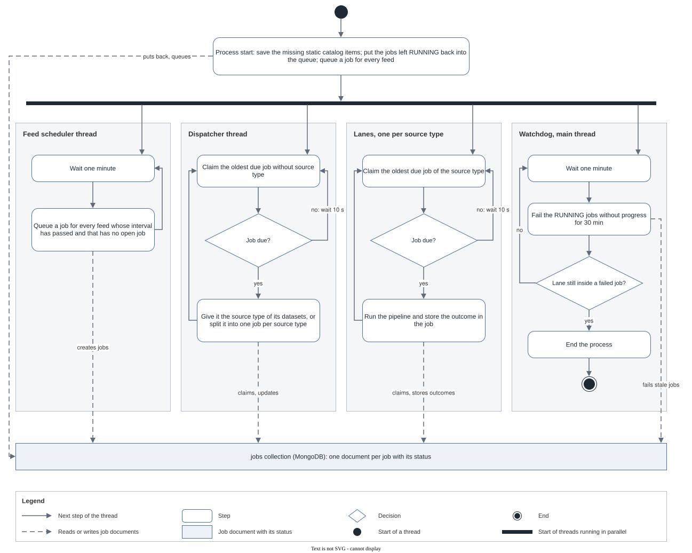
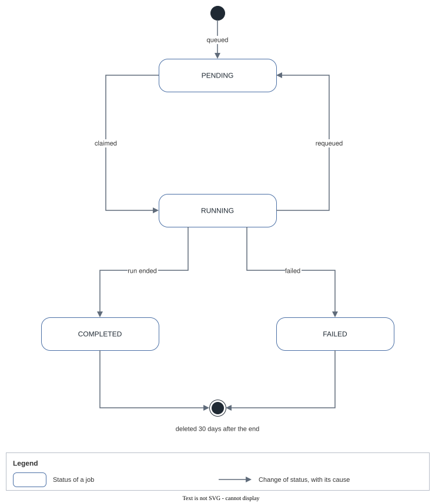
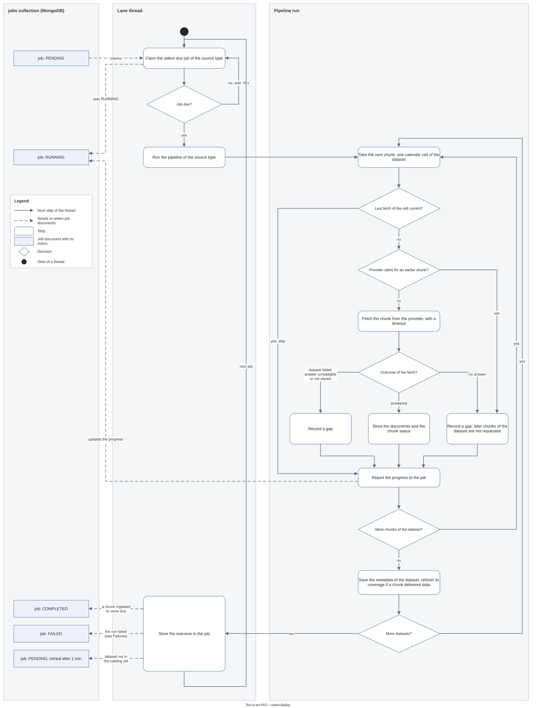

# Pipeline Service

The pipeline service fetches the data of the project from its providers and stores it in MongoDB. It keeps the feeds of `config/feeds.toml` current and processes the fetch jobs the Streamlit app queues. Both kinds of work are jobs in the `jobs` collection, so the service and the Streamlit app communicate only through the database. This page describes how the service works through its jobs and what happens when something fails.

## Threads

The threads share nothing but the `jobs` collection. There is one lane for each source type: `HAPI`, `CDAWEB`, `GFZ_POTSDAM`, `LOCAL`, `SWPC`, `IMAGES`, `DONKI`, `HEK`, `GONG`, `EPHEMERIS` and `OVATION`. The lanes run in parallel, while each provider gets at most one request at a time, and a provider that does not answer holds up only its own lane.

The main thread starts the other threads and then becomes the watchdog, which also logs a summary of each feed every hour. A thread stuck in a request cannot be stopped from outside, so the watchdog ends the whole process when a lane is still inside a job it failed, and Docker Compose starts the service again (`restart: always`).

## The job queue

Each job is one document in the `jobs` collection with its datasets, time range, source type (missing for jobs of the Streamlit app), feed, status, progress and an optional retry time. A thread finds work only by asking the database for the oldest PENDING job of its source type whose retry time has passed. Claiming sets the job to RUNNING in the same database operation, so no two threads take the same job. As the jobs live in the database, they survive a restart of the service.

A job is requeued, set back to PENDING, in three cases:

- The dispatcher gave it the source type of its datasets, so that the lane of that source type claims it. Datasets of further source types move to new PENDING jobs.
- A dataset is not in the master catalog yet. The job gets a retry time one minute later and ends FAILED one hour after its creation.
- The service starts and finds jobs left RUNNING. Only one pipeline service works on the database, so such a job was interrupted when the previous process ended.

An ended job keeps its failed chunks as `missing_chunks`; the "Data updates" panel of the dashboard reads them and names their causes in plain words. MongoDB deletes ended jobs through an expiry index.

## Start

Every start saves the catalog items of `config/sources/catalog.toml` that the master catalog lacks, so the feeds of these HAPI datasets (OMNI and the Kyoto indices) run before the metadata worker has filled the catalog. It then requeues the jobs left RUNNING and queues a job for every feed without an open job.

On the first start the database is empty: there is nothing to requeue, and every collection is created on its first write. A feed without source type, such as `goes`, waits for the catalog the metadata worker builds within minutes of its own start. With no chunk status stored yet, every feed loads its whole range, for example OMNI and the HEK regions from 1996, so the first runs take much longer than the later ones. Missing local data files are downloaded (see [Local data files](local-data.md)). On later starts the stored chunk status limits the requests to chunks that are not current.

## How a lane runs a job

The pipeline column shows a run on the calendar grid, which the pipelines of HAPI, CDAWeb, GFZ and HEK use. A chunk covers one hour, day, month or year, for most datasets chosen from their cadence so that one request holds at most about 50,000 records. The last fetch of a cell is current when it covered the chunk, its data were final at that time (for most sources: the chunk ended at least two days before the fetch) and it is younger than 90 days. The chunk status lives in the `chunk_status` collection.

The other pipelines (SWPC products, image sequences, DONKI events, the GONG magnetogram, OVATION maps, positions of planets and spacecraft, local files) do not use the grid and store no chunk status. They treat each dataset as one chunk: a failed dataset is a gap, and once the provider sent no answer, the remaining datasets of the run are not requested.

## Failures

| Failure | Handled by | Result |
| --- | --- | --- |
| The provider sends no answer: connection refused or timed out | Pipeline run | The chunk is a gap; the later chunks of the dataset in this run are gaps without a request. |
| A request fails, the answer cannot be read, or the documents cannot be stored | Pipeline run | The chunk is a gap; the run goes on with the next chunk. |
| Every chunk of the run failed | Lane | The job ends FAILED; the next run of the feed tries again. |
| Invalid request: no dataset, a dataset the pipeline does not know, a missing local file | Lane | The job ends FAILED with the reason. |
| A dataset is not in the master catalog yet | Lane or dispatcher | The job is requeued, see above. |
| Unexpected error in a pipeline | Lane | The job ends FAILED with the error; the log holds the traceback. |
| A job document does not match the job schema | Lane or dispatcher, when claiming | The job ends FAILED, naming the fields that do not match, and the next job is claimed. |
| The database fails while a job is claimed or ended | Lane or dispatcher | Logged; the thread tries again after 10 seconds. |
| A programming error while a job is claimed or ended | Lane or dispatcher | Logged as programming error; the thread tries again after 10 seconds. |
| A running job reports no progress for 30 minutes | Watchdog | The job ends FAILED, so its feed gets a new job; the process ends if its lane is still inside the job. |

## Single run

With `PIPELINE_RUN_ONCE=true` the service queues one job per feed, runs the jobs one after the other in the main thread until none is due, and ends. It starts no further threads and no watchdog. A feed without source type is left out unless the master catalog holds all of its datasets, and a job naming a dataset the catalog does not hold fails at once, as nothing fills the catalog during the run. The demo workflow uses this mode.

## Settings

| Variable | Default | Meaning |
| --- | --- | --- |
| `PIPELINE_FEEDS_FILE` | `config/feeds.toml` | The feeds whose jobs are queued on start and then in their intervals |
| `PIPELINE_CATALOG_FILE` | `config/sources/catalog.toml` | Master catalog items saved on start for datasets the catalog does not hold yet |
| `PIPELINE_DATA_DIR` | `data` | The directory of the local data files and the stored media |
| `PIPELINE_RUN_ONCE` | `false` | Run every feed once and end |
